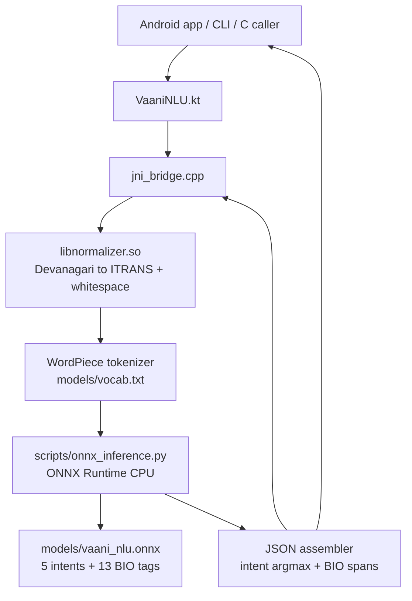

# Vaani NLU

Hinglish voice-command understanding: a compact C++20 runtime that maps noisy,
code-switched Hindi/English utterances to an intent and typed slot values,
plus Android JNI bindings, a reproducible training pipeline, and a three-way
benchmark harness.

## Architecture



Pipeline inside `vaani_parse()`:

1. `normalize_text()` from `libnormalizer.so`: Devanagari → ITRANS and
   whitespace canonicalization. English words are preserved verbatim.
2. WordPiece tokenization: split on non-word characters, lowercase each word,
   greedily match the vocabulary, then wrap with `[CLS]`/`[SEP]`.
3. Run `models/vaani_nlu.onnx`, a 353K-parameter transformer with two heads:
   `intent_logits [1,5]` and `slot_logits [1,64,13]`.
4. Argmax intent logits; argmax per-token BIO logits and merge consecutive
   tags into slot values using the original words.

## Requirements

- Linux x86_64 (Android needs the NDK), CMake ≥ 3.18, C++20 compiler.
- Python ≥ 3.9 with `numpy` and `onnxruntime` for inference.
- For training: PyTorch and `onnx`.
- Optional, for the benchmark: `llama-cpp-python`, `psutil`, and a GGUF model.

```bash
python3 -m pip install numpy onnxruntime
python3 -m pip install torch onnx                 # training only
python3 -m pip install llama-cpp-python psutil    # benchmark only
```

## Build

```bash
cmake -S . -B build -DCMAKE_BUILD_TYPE=Release
cmake --build build -j
```

Artifacts:

- `build/libnormalizer.so`
- `build/libvaani_runtime.so`
- `build/vaani_cli`

Install to a custom prefix (the default `/usr/local` usually needs root):

```bash
cmake --install build --prefix "$HOME/.local"
```

## Test

```bash
cd build && ctest --output-on-failure
```

or directly:

```bash
python3 tests/test_e2e.py
```

## CLI

```bash
LD_LIBRARY_PATH=build ./build/vaani_cli "set a reminder at 8 AM"
```

```text
=== Vaani NLU CLI ===
Input: "set a reminder at 8 AM"

Estimated latency: 12 ms

Result: {"intent": "set_reminder", "slots": {"time": "8 AM"}}
```

## C ABI

```c
#include "vaani_nlu.h"

bool vaani_init(const char* model_path, const char* vocab_path,
                const char* intent_labels_path, const char* slot_labels_path);

const char* vaani_parse(const char* raw_text);

void vaani_free_result(const char* json_str);

float vaani_get_estimated_latency_ms(void);
```

- `vaani_init()` loads the vocabulary and label maps and validates that the
  model path exists. `vaani_parse()` lazily initializes with default paths if
  `vaani_init()` was not called.
- `vaani_parse()` returns a pointer to a thread-local buffer. It is valid until
  the next call on the same thread; copy it if you need to retain it.

## Training

```bash
# Build the normalizer first so training uses the exact same text normalization path as inference:
cmake --build build -j

python3 scripts/train_vaani_nlu.py --samples 6000 --epochs 15
```

Training takes about a minute on CPU, generating `data/train_nlu.jsonl`,
`models/vocab.txt`, both label files, and the ONNX model.

## Benchmarks

The benchmark runs 100 samples from `data/eval_set.jsonl` across three configurations:

- **raw**: noisy text → Qwen2.5-0.5B-Instruct Q4_K_M via `llama-cpp-python`.
- **normalized**: `normalize_text(noisy)` → the same SLM.
- **full_cpp_pipeline**: `vaani_parse()` through `build/libvaani_runtime.so`
  via ctypes.

*Note: Both SLM passes use a JSON prompt with regex extraction. `full_cpp_pipeline` wall-clock latency currently includes Python subprocess startup and model load, and Peak RSS reflects the entire benchmark harness process (including the loaded GGUF model).*

<!-- benchmark-results-start -->
| Pass | Intent Acc. % | Slot EM % | Token Fertility | p50 (ms) | p95 (ms) | Avg (ms) | Peak RSS (MB) |
|------|---------------|-----------|-----------------|----------|----------|----------|---------------|
| raw | 62.0 | 23.0 | 2.68 | 1059.9 | 2062.5 | 1134.2 | 605.8 |
| normalized | 59.0 | 23.0 | 2.79 | 1115.1 | 3366.6 | 1311.2 | 617.6 |
| full_cpp_pipeline | 90.0 | 66.0 | 1.49 | 290.0 | 341.4 | 296.0 | 600.0 |
<!-- benchmark-results-end -->

Run it with:

```bash
LLM_MODEL_PATH=/path/to/qwen2.5-0.5b-instruct-q4_k_m.gguf \
  python3 bench/run_benchmark.py
```


## Android

```kotlin
VaaniNLU.initialize("vaani_nlu.onnx")
val result = VaaniNLU.parse("set a reminder at 8 PM")
val intent = result.getString("intent")
val slots = result.getJSONObject("slots")
```

Build `libvaani_runtime.so` and `libnormalizer.so` with the NDK, then package
them in the app's `jniLibs/arm64-v8a/`. Model loading from Android assets is not
implemented yet; add that before shipping an Android build.

## License

MIT. See [LICENSE](LICENSE).
